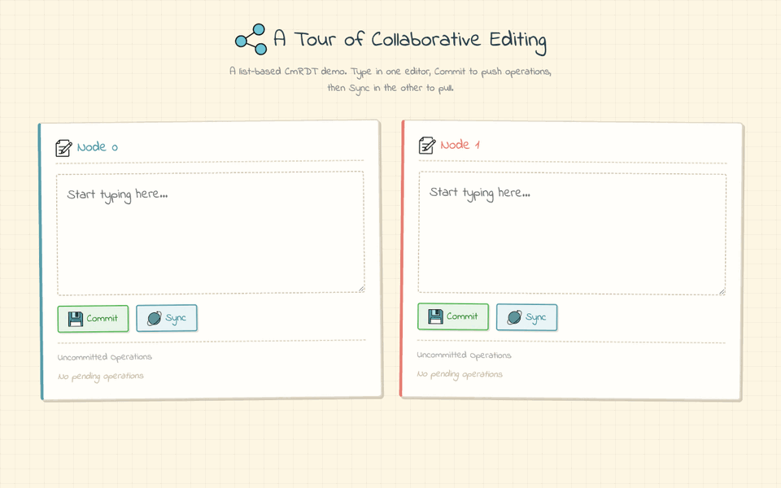

# A Tour of Collaborative Editing

A list-based CmRDT (Commutative Replicated Data Type) for collaborative text editing. See [`src/crdt/README.md`](src/crdt/README.md) for algorithm details.

Please also refer to this [blog](https://drstarry.github.io/posts/2016-12-05-collaborative-editing).

## Demo

Two in-browser editors share a CRDT document. **Commit** pushes operations to the peer; **Sync** pulls them in. The editors converge regardless of operation order.



## Guarantees

- Eventual delivery
- No conflict (commutative operations)
- Lossless (idempotent deletes)

## Getting Started

```bash
npm install
npm run dev
```

Open http://localhost:3000.

## Scripts

| Command | Description |
| --- | --- |
| `npm run dev` | Start Vite dev server |
| `npm run build` | Type-check + production build |
| `npm test` | Run CRDT tests (Vitest) |

## Tech Stack

- **CRDT core** — TypeScript, zero dependencies
- **UI** — React 19, Vite 6

## Credits

- [Freepik](http://www.flaticon.com/authors/freepik), [Madebyoliver](http://www.flaticon.com/authors/madebyoliver) for icons.

## License

MIT
